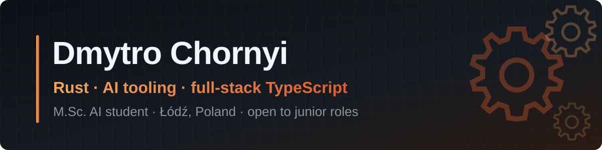

  

  
  
  

## 👋 About me

I'm a Computer Science graduate, now doing an **M.Sc. in Artificial Intelligence** at SAN (Społeczna Akademia Nauk) in Łódź, Poland.

I like building things end to end. I've built a factory game in Rust, a backtesting engine that crunches 10 years of market data, MCP servers and agent skills for Claude, and web apps, from a Telegram Mini App to a client site. I'm most at home in **Rust**, **Python** and **TypeScript**, and I'm happy to pick up whatever a team uses.

## 🦀 Rust & data

**[Cogworks](https://github.com/dmytrochornyi/cogworks)**: a cozy 2D automation game. Mine ore, lay belts and robotic arms, climb a research tree, keep the smoke-sensitive hives at bay, and wake the Grand Engine. It has a hand-painted look and a lo-fi soundtrack. 
 

**Algorithmic Backtesting Engine** *(private)*: a Rust engine that runs strategies over 10 years of time-series data. It resolves 7,575 trades, is parallelised with Rayon, and is paired with a Python analytics pipeline. 
  

**Trade Data Analytics Pipeline** *(private)*: an OOP Python pipeline with schema validation and pandas/NumPy metric computation that analyses the engine's trade output. 
  

## 🤖 AI & LLM tooling

**[SAN AI: Academic Chatbot](https://github.com/dmytrochornyi/chatbot-san-projekt)** *(team project)*: a RAG chatbot that answers questions from university documents, running on a local Llama 3.2. 
    

**[olx-mcp](https://github.com/dmytrochornyi/olx-mcp)**: an MCP server that lets AI assistants search OLX.pl without an account. When an offer's description is weak, the model is pointed to its photos so it can check what's actually being sold. 
 

**[delegate-reasonix](https://github.com/dmytrochornyi/delegate-reasonix)**: a Claude Code skill that splits work between two agents. Claude plans and audits, and Reasonix (DeepSeek) writes the code. This saves tokens on large tasks without trusting the second agent's own summary. 
 

## 🌐 Web apps

**[HabitFlow](https://github.com/dmytrochornyi/habitflow)**: a habit tracker that runs as a Telegram Mini App, with Today and Progress views (social features in progress). It's backed by Supabase/Postgres and tested with Vitest. 
     

**[Dizajnownia](https://github.com/dmytrochornyi/dizajnownia-svelte-app)**: a website for a graphic design and printing studio, with service pages, a Markdown blog and GSAP animations. It's pre-rendered as a static site. 
  

## 🧰 Tech stack

   
   
  

**AI / LLM:** RAG · LangChain · pgvector · Ollama · MCP · agent skills 
**Data:** pandas · NumPy · SQL
